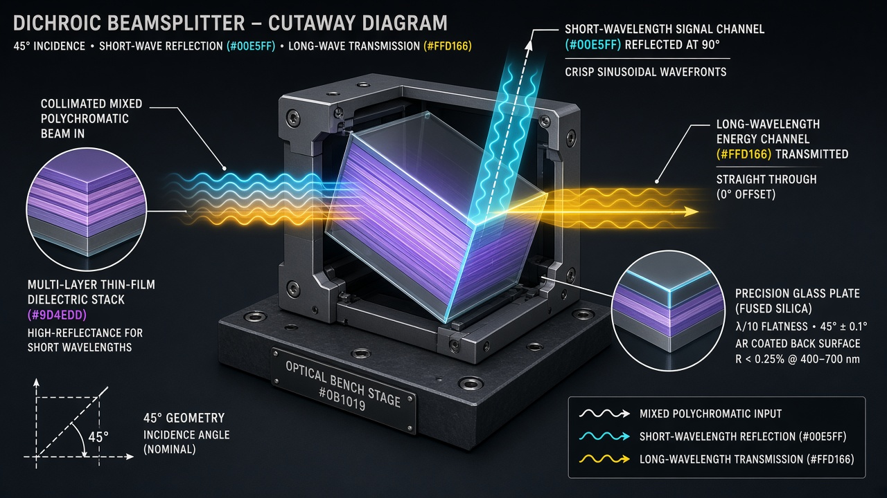

# Inside the Dichroic Beamsplitter: How Quarter-Wave Dielectric Stacks Route Light by Wavelength, and How We Built a 1,020-Frame Deterministic Explainer

**Title Tag:** Dichroic Beamsplitter Explained: Thin-Film Interference, AOI Blue-Shift, S/P Polarization & Plate vs. Cube Trade-Offs  
**Meta Description:** Learn how a dichroic beamsplitter separates wavelengths via quarter-wave dielectric stacks, why angle of incidence and polarization shift the cutoff edge, when to choose a plate vs. a cemented cube, and how we built a 1,020-frame deterministic optical explainer in TypeScript.  
**Primary Entity & Vertical:** Dichroic Beamsplitter (Precision Optical Components)  
**Canonical Live Interactive Stage:** `https://mizcausevic-dev.github.io/dichroic-beamsplitter-explainer/`  
**Source Repository:** `https://github.com/mizcausevic-dev/dichroic-beamsplitter-explainer`



---

## BLUF (Bottom Line Up Front)

A **dichroic beamsplitter** partitions a mixed-wavelength optical beam into two distinct spectral channels through coherent thin-film interference rather than bulk material absorption. By depositing alternating high-refractive-index ($n_H$) and low-refractive-index ($n_L$) dielectric layers of quarter-wave optical thickness onto a glass or fused-silica substrate, optical engineers force one wavelength band (the stopband) to sum constructively in reflection while allowing the remaining band (the passband) to interfere destructively in reflection and propagate forward.

In practice, however, no dichroic optic behaves like an ideal step-function switch. Optical performance is strictly coupled to four design variables: **wavelength ($\lambda$)**, **angle of incidence (AOI, $\theta_i$)**, **polarization state ($s$-polarized TE vs. $p$-polarized TM)**, and **substrate geometry (45-degree plate vs. cemented prism cube)**. Ignoring any of those four variables during optical layout causes spectral edge shifts, polarization-induced passband steps, lateral beam walk-off ($\Delta s$), or laser-induced cement failure.

To make these coupled physical mechanisms inspectable frame by frame, we built a **34-second, 1,020-frame (at 30 fps, indexed `0–1019`) deterministic anatomy explainer** in React, TypeScript, and SVG. Below is the complete optical engineering breakdown and the software architecture behind the interactive schematic.

---

## 1. Why Absorptive Colored Glass Fails Where Dichroic Interference Wins

When an optical instrument must separate fluorescence emission from laser excitation, combine red/green/blue projection channels, or isolate a pump laser from a signal beam, standard absorptive glass filters fail on two counts:

1. **Discarded Photon Flux:** An absorptive filter removes unwanted wavelengths by converting photon energy into lattice vibrations (heat) inside the doped glass substrate. Once absorbed, that spectral channel cannot be routed to a second detector, reference photodiode, or co-aligned imaging camera.
2. **Thermal Lensing and Damage:** Under high continuous-wave (CW) irradiance or pulsed laser fluence, absorbed optical power heats the substrate unevenly. The resulting radial temperature gradient changes the local refractive index ($dn/dT$) and bulges the substrate faces, introducing thermal lensing or catastrophic fracture.

A **dichroic beamsplitter** replaces absorption with **phase-locked electromagnetic routing**. Mounted at a nominal angle of incidence (commonly $45^\circ$ for orthogonal $90^\circ$ routing), the interference coating reflects the stopband along a perpendicular port while transmitting the passband straight through the substrate. Apart from a small residual loss budget (interface scattering, trace coating absorption, and residual rear-surface reflection), total optical energy is conserved across the two useful output ports:

$$R(\lambda, \theta, \text{pol}) + T(\lambda, \theta, \text{pol}) + \text{Loss}(\lambda) = 1$$

---

## 2. The Physics of the Quarter-Wave Dielectric Stack

If a single air-to-glass interface reflects only about 4% of incident light at normal incidence, how does a dielectric mirror reflect more than 98% of a selected spectral band without using a single atom of reflective metal?

The mechanism relies on **multi-beam interference across an alternating dielectric stack**, shown in the sectional cutaway of Act 2 (`Frames 150–299`) of our explainer.

### Alternating High and Low Refractive Indices

During vacuum deposition (such as ion-beam sputtering, magnetron sputtering, or electron-beam evaporation), the substrate is coated with alternating layers of:

- **High-Index Dielectric ($n_H$):** Materials such as titanium dioxide ($\text{TiO}_2$, $n \approx 2.3–2.4$) or tantalum pentoxide ($\text{Ta}_2\text{O}_5$, $n \approx 2.1$).
- **Low-Index Dielectric ($n_L$):** Materials such as silicon dioxide ($\text{SiO}_2$, $n \approx 1.46$) or magnesium fluoride ($\text{MgF}_2$, $n \approx 1.38$).

At every interface between Layer $k$ and Layer $k+1$, Fresnel equations dictate that a portion of the incident wave amplitude reflects and the remainder transmits.

### Boundary Phase Inversion Plus Quarter-Wave Path Delay

Two phase rules govern whether those dozens of partial reflections reinforce or cancel each other:

1. **Reflection Phase Shift at Index Boundaries:** When an electromagnetic wave travelling in a lower-index medium ($n_L$) reflects off a higher-index medium ($n_H$), its electric field undergoes a **$\pi$ radian ($180^\circ$, or half-wavelength)** phase inversion. When it reflects off a lower-index boundary ($n_H \to n_L$), it reflects with **$0$ radian** phase shift.
2. **Quarter-Wave Optical Thickness ($\lambda_0 / 4$):** Each individual layer’s physical thickness $d$ is controlled so that its effective optical path length at internal refraction angle $\theta$ equals one-quarter of the target stopband center wavelength $\lambda_0$:

$$n \cdot d \cdot \cos(\theta) = \frac{\lambda_0}{4}$$

When a wave enters a quarter-wave layer, travels to the next interface, reflects, and travels back to the top of that layer, it covers the thickness twice. A round-trip distance of $2 \times (\lambda_0 / 4) = \lambda_0 / 2$ introduces a geometric phase delay of exactly **$\pi$ radians ($180^\circ$)**.

Combine the $\pi$ geometric round-trip delay with the alternating $0$ and $\pi$ boundary inversions, and every reflected wavelet in the stopband exits the stack with a net phase difference of $\Delta\phi = 2\pi m$. They sum **constructively in phase**, driving stopband reflectance $R(\lambda)$ toward unity as layer count increases. Meanwhile, wavelengths in the passband fail the phase-matching condition; their partial reflections cancel destructively, forcing the energy forward into the transmitted beam $T(\lambda)$.

---

## 3. Four Real-World Engineering Limits Every Optical Architect Must Account For

Marketing diagrams often depict a dichroic beamsplitter as a magic prism that splits colors cleanly at any angle with zero side effects. In real instrumentation, four physical constraints bound every design (`Frames 510–1019`):

### Limit 1: Angle-of-Incidence (AOI) Blue-Shift and Cone Smearing

Look closely at the phase equation: $\text{OPD} = 2 \cdot n \cdot d \cdot \cos(\theta)$. As the external angle of incidence $\theta_i$ increases (for example, tilting a $45^\circ$ dichroic toward $55^\circ$), the internal angle $\theta$ increases and $\cos(\theta)$ decreases. For constructive interference to still occur across the fixed physical layer thickness $d$, the wavelength $\lambda$ must decrease proportionally:

$$\lambda(\theta_i) = \lambda_0 \sqrt{1 - \left(\frac{n_0 \sin\theta_i}{n_{\text{eff}}}\right)^2}$$

**Operational Consequence:** Increasing the angle of incidence always shifts the spectral transition edge toward **shorter wavelengths (blue-shift)**. Decreasing AOI toward normal incidence shifts the transition edge toward **longer wavelengths (red-shift)**. Furthermore, if you place a dichroic beamsplitter inside a strongly converging or diverging cone of light (high numerical aperture) rather than a collimated space, marginal rays at $+\Delta\theta$ and $-\Delta\theta$ experience different cutoff wavelengths across the clear aperture, smearing the spectral edge and introducing spatial color gradients.

### Limit 2: S-Polarization (TE) vs. P-Polarization (TM) Splitting at Oblique Incidence

At normal incidence ($\theta_i = 0^\circ$), the plane of incidence is degenerate; $s$-polarized light (electric field perpendicular to the plane of incidence, TE) and $p$-polarized light (electric field parallel to the plane of incidence, TM) experience identical Fresnel reflection coefficients.

At a $45^\circ$ angle of incidence, the effective optical admittance of each layer diverges sharply for the two polarizations:

- **$s$-polarized light (TE)** sees a larger effective index contrast between $n_H$ and $n_L$, producing a **wider reflectance stopband** and a steeper transition slope.
- **$p$-polarized light (TM)** sees a reduced effective index contrast (approaching zero near Brewster’s angle at individual interfaces), producing a **narrower reflectance stopband** and shifting its cutoff wavelength relative to the $s$-polarized edge.

**Operational Consequence:** If your illumination source is unpolarized (equal parts $s$ and $p$), the net transmittance curve $T_{\text{avg}}(\lambda) = \frac{1}{2}[T_s(\lambda) + T_p(\lambda)]$ will exhibit a two-step shoulder or a broadened transition zone spanning the gap between $\lambda_{\text{cutoff},s}$ and $\lambda_{\text{cutoff},p}$. Precision polarization-sensitive paths must control input polarization explicitly.

### Limit 3: Plate vs. Cube Architecture Trade-Offs

As documented in Edmund Optics’ reference literature on beamsplitters and optical prisms, engineers must choose between two mechanical topologies:

| Engineering Criterion | 45° Dichroic Plate Beamsplitter | Cemented Dichroic Cube Beamsplitter | Architectural Decision Rule |
| :--- | :--- | :--- | :--- |
| **Transmitted Beam Walk-Off ($\Delta s$)** | Lateral translation $\Delta s = t \sin(\theta_1 - \theta_2)/\cos\theta_2$ proportional to plate thickness $t$. | Zero lateral walk-off at normal entrance/exit faces; coaxial input and output. | Choose **Cube** when drop-in coaxial alignment is mandatory without re-centering downstream optics. |
| **Rear-Surface Ghosting** | Uncoated or imperfectly AR-coated rear face produces a secondary parallel reflection. | Dielectric stack is buried between index-matched glass prisms; exterior faces AR-coated. | Choose **Cube** or a **wedged, high-AR Plate** in high-contrast imaging paths. |
| **Aberrations in Non-Collimated Space** | Tilted plane-parallel plate introduces astigmatism and coma in converging beams. | Symmetric normal-incidence faces eliminate plate astigmatism (adds uniform spherical path). | Always place **Plate** dichroics in infinity-corrected (collimated) optical spaces. |
| **Laser Damage Threshold (LIDT)** | Very high LIDT when refractory oxide films are deposited on monolithic fused silica. | Optical cement at the hypotenuse absorbs UV/high-power flux and limits CW/pulsed fluence. | Choose **Plate** (or optically contacted cube) for high-power CW and pulsed laser systems. |
| **Compactness & Filter Turrets** | Thin, lightweight rectangular or circular profile; fits standard microscope filter cubes. | Heavier, thicker volume; simpler flush mounting on flat baseplates. | Standardize on **Plate** for multi-channel epifluorescence turrets and low-mass heads. |

### Limit 4: Finite Transition Width, Passband Ripple, and Non-Zero Loss

No physical coating stack contains an infinite number of layers or zero impedance mismatch with the surrounding media. Every real dichroic specification must budget for:

- **Transition Width:** The spectral span (in nanometers) required to transition from $R > 90\%$ in the stopband to $T > 90\%$ in the passband.
- **Passband Ripple:** Small oscillatory variations in $T(\lambda)$ across the transmission band caused by residual cavity interference between the stack, substrate, and rear AR coating.
- **Insertion Loss:** Scattering from nanoscale surface roughness plus intrinsic extinction coefficient ($k$) absorption in the dielectric oxides.

---

## 4. Designing the 1,020-Frame Deterministic Anatomy Explainer

To translate these optical principles into an interactive inspection tool without decorative fluff or unphysical particle effects, we designed a deterministic timeline engine (`src/data/beamsplitterTimeline.ts`) locked to **34 seconds at 30 frames per second (`1,020` frames indexed `0–1019`)**.

### Why Deterministic State ($S = f(\text{frame})$) Matters for Technical Explainers

In standard web animations, playheads trigger asynchronous CSS animations or increment mutable position variables on each `requestAnimationFrame` tick. As soon as an engineer pauses at Frame `240`, steps backward by 1 frame (`-1f`), or drags the scrubber from Act 5 back to Act 2, stateful animations desynchronize.

In our architecture, every visual parameter on the stage is a pure mathematical function of the integer frame index `frame ∈ [0, 1019]` and the four user bench settings (`filterMode`, `architecture`, `polarization`, `userAoiDeg`):

```typescript
export function computeTimelineState(rawFrame: number): InterpolatedTimelineState {
  const frame = clamp(Math.round(rawFrame), 0, TOTAL_FRAMES - 1);
  const timeSec = frame / FPS;
  const currentPhase = TIMELINE_PHASES.find(
    (p) => frame >= p.startFrame && frame <= p.endFrame
  )!;

  // Deterministic coherent wave phase (radians) and camera interpolation
  const wavePhaseRad = frame * 0.24;
  const aoISweepDeg =
    frame >= 750 ? Math.sin(((frame - 750) / (1019 - 750)) * Math.PI * 2) * 7.5 : 0;
  // ...
}
```

### The 5-Act Camera and Causal Choreography

1. **Frames 0–149 (0–5s) | Reveal Mixed Wavelengths:** Establishes the complete optical bench assembly (collimator input port, kinematic mount, substrate, orthogonal $90^\circ$ and $0^\circ$ detector ports) and executes a smooth push toward the active $45^\circ$ interface as co-propagating short-wavelength (`#00E5FF` cyan) and long-wavelength (`#FFD166` gold) sinusoidal wavepackets enter.
2. **Frames 150–299 (5–10s) | Show Selected Spectral Response:** Zooms into the active region and expands the sectional cutaway inset (`~25,000×` schematic magnification) showing alternating $n_H / n_L$ quarter-wave layers (`#9D4EDD` violet and `#00E5FF` cyan), Fresnel boundary reflection arrows, and the phase condition $n \cdot d \cdot \cos\theta = \lambda_0 / 4$ while retaining adjacent substrate orientation.
3. **Frames 300–509 (10–17s) | Separate Wavelength Paths:** Tracks the causal bifurcation as the stopband reflects orthogonally to the top port and the passband refracts through the substrate (displaying plate Snell walk-off $\Delta s$ and the rear anti-reflective coating) toward the right port.
4. **Frames 510–749 (17–25s) | Compare Incident and Output Spectra:** Foregrounds the qualitative spectral transfer coordinate plane, plotting the broadband incident distribution against $R(\lambda)$, $T(\lambda)$, passband ripple, finite cutoff slope around $\lambda_c$, and the explicit energy conservation ledger.
5. **Frames 750–1019 (25–34s) | Mark Design Dependence:** Pulls back to the full system view while sweeping the angular acceptance cone ($\pm\Delta\theta$) to demonstrate AOI blue-shift and $s/p$ polarization cutoff splitting.

### Visual Token Discipline

Every color on the stage serves an explicit explanatory role on the `#0B1019` dark technical canvas:

- **Cyan (`#00E5FF`):** Primary signal transport / shorter-wavelength band and anti-reflective low-index layers.
- **Gold (`#FFD166`):** Energy / actuation channel / longer-wavelength band and boundary warning callouts.
- **Violet (`#9D4EDD`):** High-index dielectric stack control layers, surface normal vector $\hat{n}$, and polarization/AOI state overlays.
- **Muted Structural Slate (`#1E293B` / `#64748B`):** Machined kinematic mounts, collimator housings, and borosilicate/fused-silica substrates.

---

## 5. How to Use and Extend This Architecture

Whether you are specifying a dichroic optic for a fluorescence microscope or building deterministic hardware explainers for another precision engineering vertical:

1. **Inspect the Live Stage:** Open the live interactive application, scrub across all 5 acts (`Frames 0–1019`), and toggle between **Longpass / Shortpass**, **45° Plate / Cemented Cube**, **Unpolarized / S-Pol / P-Pol**, and **30°–60° AOI**.
2. **Generate a Verification Spec:** Click **Configure Custom Dichroic Spec / RFQ Checklist** in the parameter bench to export a structured engineering specification worksheet, then verify candidate catalog parts against manufacturer measured $R(\lambda)$ and $T(\lambda)$ datasheets before release.
3. **Repurpose Across Verticals:** Because the state engine separates timeline choreography (`computeTimelineState`) from domain transfer physics (`computeQualitativeSpectrum`), the exact same 1,020-frame SVG architecture adapts directly to RF cavity diplexers, acoustic metamaterial bandgaps, and membrane gas separators.

---

### Primary Technical References & Scope Note

- **Edmund Optics: What Are Beamsplitters?**  
  [https://www.edmundoptics.com/knowledge-center/application-notes/optics/what-are-beamsplitters/](https://www.edmundoptics.com/knowledge-center/application-notes/optics/what-are-beamsplitters/)
- **Edmund Optics: Introduction to Optical Prisms**  
  [https://www.edmundoptics.com/knowledge-center/application-notes/optics/introduction-to-optical-prisms/](https://www.edmundoptics.com/knowledge-center/application-notes/optics/introduction-to-optical-prisms/)

*Reference Scope Disclosure:* These sources ground the physical architecture and mechanism of plate and cube beamsplitters; they do not independently validate illustrative camera choreography or represent a measured datasheet for a specific proprietary coating stack. Always verify selected optical components against manufacturer lot documentation before production release.
